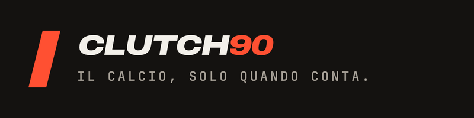

  

# Clutch90

**Il calcio, solo quando conta.**

Clutch90 is instant fantasy football on big matches. No season, no long-term commitment: build a roster with 100 credits before kick-off, challenge your friends with a link, and find out who read the match better at the 90th minute.

## How it works

- **Instant**: one match, one roster, one result.
- **Competitive**: tactical reading beats luck. Every rating is our own newspaper-style rating, explained with a short note and the numbers behind it.
- **Social**: challenges travel as a WhatsApp link and are playable from the browser, with no install and no account needed to accept.

### Challenge types and modes

Every challenge picks a **type** (how many matches) and a **mode** (how the roster is built). All four combinations exist.

- **Clutch ONE**: 1 big match, players only from the two teams on the pitch. 90 minutes.
- **Clutch MULTI**: 2 or 3 of the weekend's 9 big matches, with a single hybrid roster across all of them. Friday to Monday night.
- **RUSH7**: 7 players (1 goalkeeper + 6 outfield) in one of four formations, 100 credits.
- **CAGE**: 4 players (1 goalkeeper + 3 free), 100 credits, fewer and pricier picks.
- Each player locks 15 minutes before their own match kicks off.
- **Save = Score**: every unspent credit is +1 point, up to 10.
- **Indice Clutch**: your score as a share of the perfect roster, so every challenge is comparable. Levels and leaderboards are kept separate per mode.

## Free game of skill, not gambling

Clutch90 is free to play. There are no entry fees, no money or valuable prizes, no purchase that improves your score, and no bookmaker or gambling ads. Forfeits ("pegno") are free text only. Everything paid is cosmetic or informational.

## Play

[clutch90.app](https://clutch90.app)
